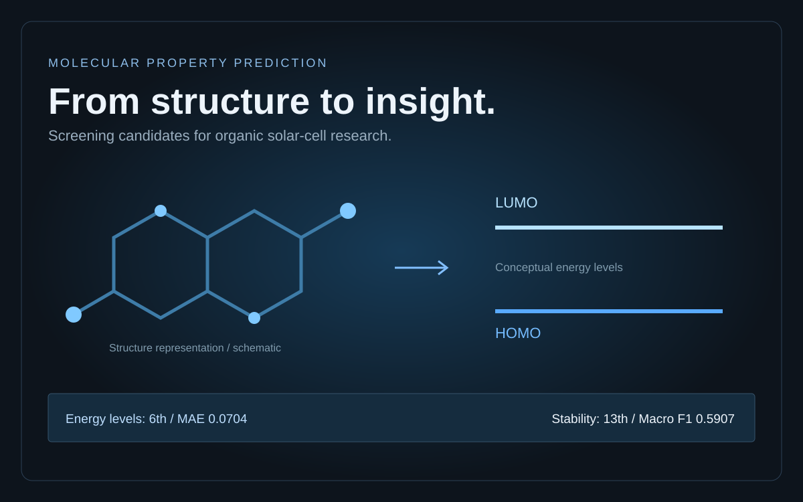

# Predictive Modeling for Energy Level and Stability Determination of Organic Photovoltaics

**Predicting HOMO and LUMO energy levels from molecular structure, in a school challenge inspired by organic solar-cell research.**

A Year 1 Block B project by **Lucan den Dekker**, Applied Data Science & AI, Breda University of Applied Sciences. The project brief placed the work in the context of **OMEGA Research Lab at the KAUST Solar Center**. This is an educational project, not a claim that the models were deployed in the lab.

[My portfolio](https://lucandendekker.nl/)

> [!NOTE]
> **This is everything I am able and permitted to share from this school project.**
> The course's simulated target values (HOMO, LUMO and stability), the course datasets and the models trained on them remain private at the lecturer's request. What is shared here, with the lecturer's permission, is my own code, my approach and the final Kaggle results. See [The data and what is not published](#the-data-and-what-is-not-published).



## The problem: which molecules are worth testing?

Organic photovoltaics (OPVs) use carbon-based materials to convert sunlight into electricity. They offer possibilities for lightweight, flexible solar cells, but identifying suitable molecules is difficult. Synthesising and experimentally characterising every candidate takes time and resources.

The assignment asked whether machine learning could help screen candidates from their **chemical structure**, so researchers could prioritise molecules for further investigation.

The target properties were:

- **HOMO**: the highest occupied molecular orbital energy level.
- **LUMO**: the lowest unoccupied molecular orbital energy level.
- **Stability**: whether a molecule keeps its properties, classified as low, medium or high.

Their relative energies matter when considering candidate materials and energy-level alignment. Predicting these properties is a screening task; it does not by itself establish a solar cell's efficiency, durability or suitability for production.

## The Kaggle competition

The block included **two Kaggle competitions**: Energy Level Prediction for HOMO/LUMO regression and Molecular Stability Prediction for classification. Both used the same **200 held-out molecular structures**, with different target columns and evaluation metrics.

The regression competition used **mean absolute error (MAE)** and the classification competition used **macro F1**. The results below are from the final **private** leaderboards.

### Final private leaderboard results

| Competition | Rank | Private score |
|---|---:|---|
| Energy Level Prediction (HOMO/LUMO) | **6th** | **MAE 0.0704** |
| Molecular Stability Prediction | **13th** | **Macro F1 0.5907** |

These are two separate competition results, transcribed from the project's private-leaderboard screenshots. They are not separate HOMO and LUMO scores and are not local cross-validation metrics. The client's target for the regression task was an MAE below 0.1.

## Approach

The workflow followed CRISP-DM and successive model iterations:

1. Understand the materials-screening question and define the regression targets.
2. Inspect the supplied molecular data and additional molecular records accessed through the SQL module, and remove overlapping structures.
3. Represent molecular structure using **SMILES**, **RDKit descriptors** (176) and count-based **Morgan fingerprints** (radius 2 and 3, 2048 bits each).
4. Clean features: median imputation, a near-zero-variance filter and a correlation filter (> 0.95) on the RDKit descriptors.
5. Train separate HOMO and LUMO regression pipelines with **XGBoost**, tuned with **Optuna** over 5-fold cross-validation.
6. Build an inference pipeline that turns new SMILES into HOMO/LUMO predictions and generate the submission for the unseen competition molecules.

For stability classification I used LightGBM on the same kind of RDKit features, changing one thing at a time per iteration and removing unstable descriptors such as `Ipc`.

## The data and what is not published

The molecular structures come from the public **Harvard Organic Photovoltaic Dataset (HOPV15)**:

> Lopez, S. A., Pyzer-Knapp, E. O., Simm, G. N., Lutzow, T., Li, K., Seress, L. R., Hachmann, J. & Aspuru-Guzik, A. (2016). *The Harvard organic photovoltaic dataset.* Scientific Data, 3, 160086. https://doi.org/10.1038/sdata.2016.86
>
> Data: https://doi.org/10.6084/m9.figshare.1610063 (CC BY 4.0)

For the course, the **HOMO, LUMO and stability target values were simulated** by the block's lecturers. Those simulated values belong to the course and are deliberately **not** included in this repository, in any form:

- no training, competition or SQL datasets and no submission files;
- **no trained models**, because a model trained on the simulated targets would let anyone approximate them;
- notebook outputs are cleared, so no predictions, target ranges or plots are shown.

This repository is shared with the lecturer's permission on that basis. What remains is my own code, the approach and the final competition scores.

Because the targets were simulated, a low competition MAE describes performance on an educational benchmark. It should not be read as demonstrated accuracy on real laboratory measurements.

## Repository contents

```text
README.md                           Problem, approach, data and Kaggle results
notebooks/01_homo_training.ipynb    HOMO training pipeline (features, filtering, Optuna, XGBoost)
notebooks/02_lumo_training.ipynb    LUMO training pipeline
notebooks/03_inference.ipynb        Inference pipeline that produced the competition submission
docs/problem-and-competition.md     Assignment scope and evaluation notes
images/project-overview.svg         Conceptual project overview
requirements.txt                    Packages used by the notebooks
```

The notebooks are the code as I wrote it for the course. They expect the course datasets (`xy_df.csv` and `extra_data_200k.csv`), which are not included, so they cannot be rerun from this repository as-is.

## Sources

- BUas Year 1 Block B brief: *Predictive Modeling for Energy Level and Stability Determination of Organic Photovoltaics*.
- BUas Block B DataLab task descriptions, especially Task 5: Classification and Task 6: Regression.
- Lopez et al. (2016), *The Harvard organic photovoltaic dataset*, Scientific Data 3, 160086.
- The project's private-leaderboard screenshots.

This write-up summarises the project evidence. It does not reproduce the full course materials or invent a competition award, total entrant count or production deployment.
